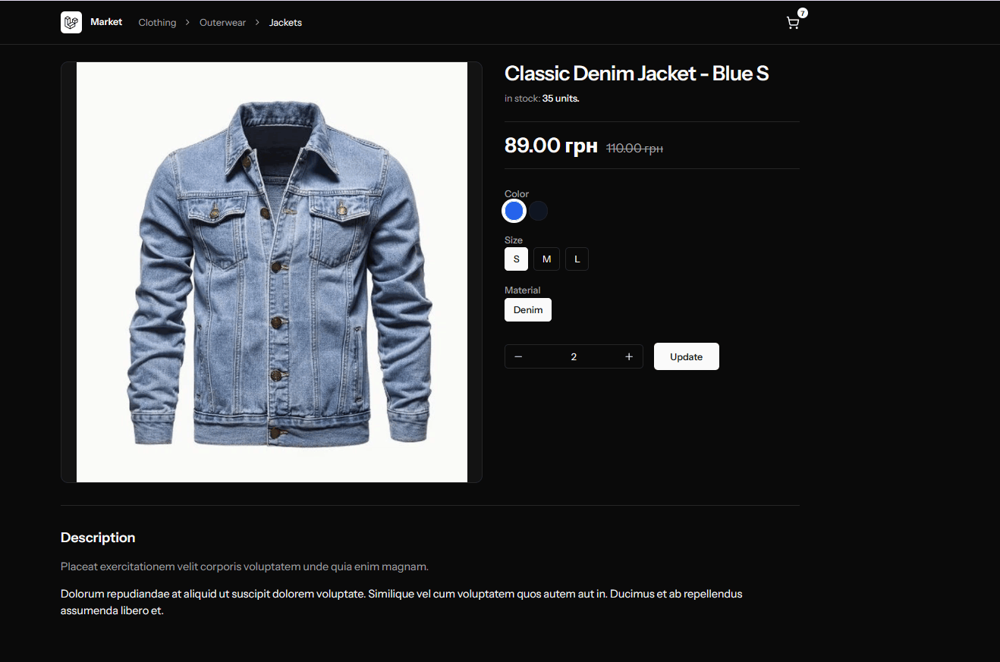
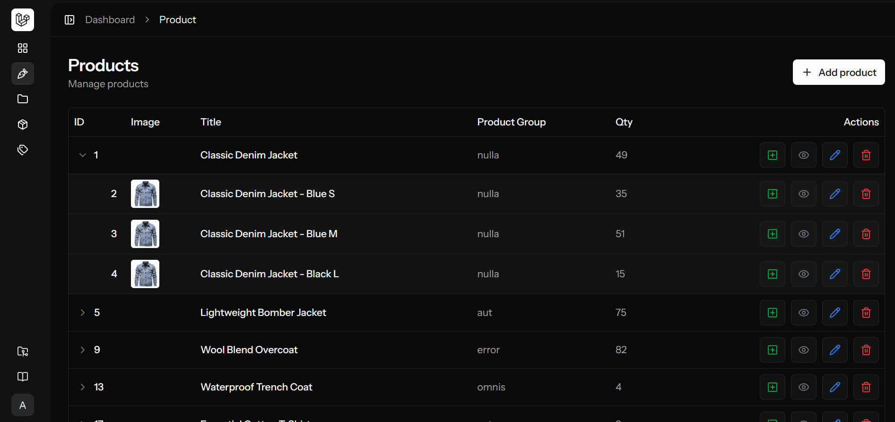

# Market

A learning e-commerce project built with Laravel 13, Inertia v3 and Vue 3: a storefront (catalog, product page with variants, cart) and an admin panel for managing products, categories, parameters and product groups.

## Screenshots

### Product page

Variant selection by parameters (color, size, material), discounted price, stock level, adding to cart.



### Admin panel: products

Hierarchical product list (a parent product and its variants) with actions to create a variant, view, edit and delete.



## Features

**Storefront**

- Catalog by category with filters
- Product page: gallery, variants by parameters, related products
- Cart with a counter in the header

**Admin panel** (`/admin`)

- Product CRUD with variants (child products) and replication
- Image upload and removal
- Categories, parameters, product groups
- Access restricted to users with the admin role

## Stack

**Backend**

- PHP 8.5, Laravel 13
- Inertia v3 (`inertiajs/inertia-laravel`)
- Laravel Fortify (authentication), Laravel Wayfinder (typed routes for TypeScript)
- PostgreSQL
- Pest, Larastan (PHPStan), Pint, Rector

**Frontend**

- Vue 3.5 + TypeScript
- Tailwind CSS 4, shadcn-vue (reka-ui), vue-sonner
- Vite

## Architecture

- Routes: `routes/client.php`, `routes/admin.php`, `routes/settings.php`
- Controllers: `app/Http/Controllers/{Client,Admin,Settings}`
- Business logic: `app/Services`
- Inertia responses are built with API Resources (`app/Http/Resources`)
- Layouts are assigned centrally in `resources/js/app.ts`

## Installation

```bash
git clone https://github.com/kruger1984/market.git
cd market
composer setup
```

Configure the PostgreSQL connection in `.env` (`DB_CONNECTION=pgsql` and the other `DB_*` variables), then run:

```bash
php artisan storage:link
php artisan app:refresh
```

`app:refresh` recreates the database, creates the admin user and fills the catalog with demo data.

Default admin: `admin@gmail.com` / `admin@gmail.com`.

## Running

```bash
composer dev
```

Starts the server, the queue worker and Vite together.

## Checks

```bash
php artisan test
composer stan
vendor/bin/pint
npx vue-tsc --noEmit
```
